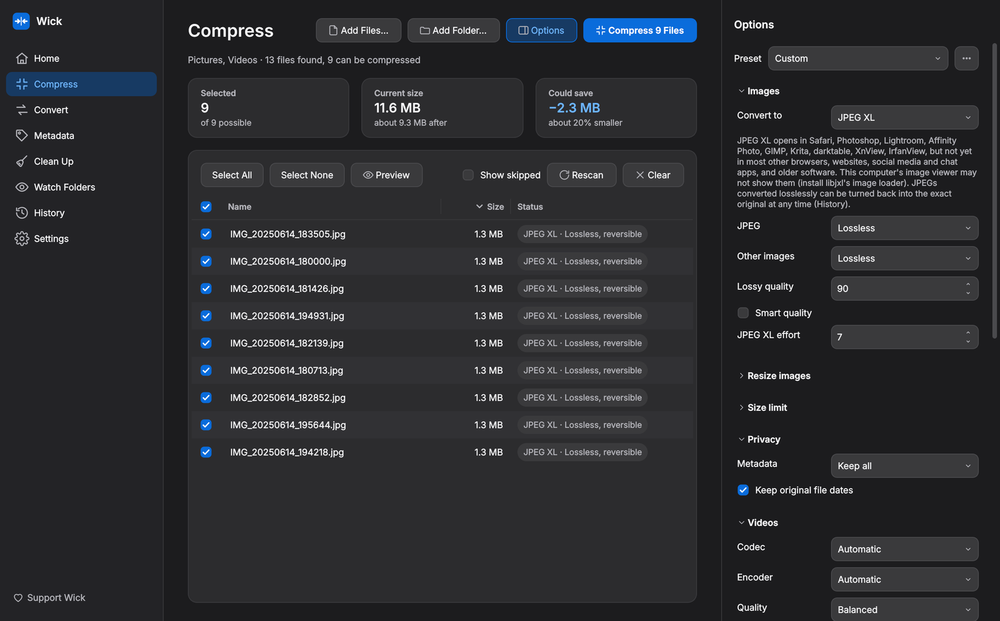
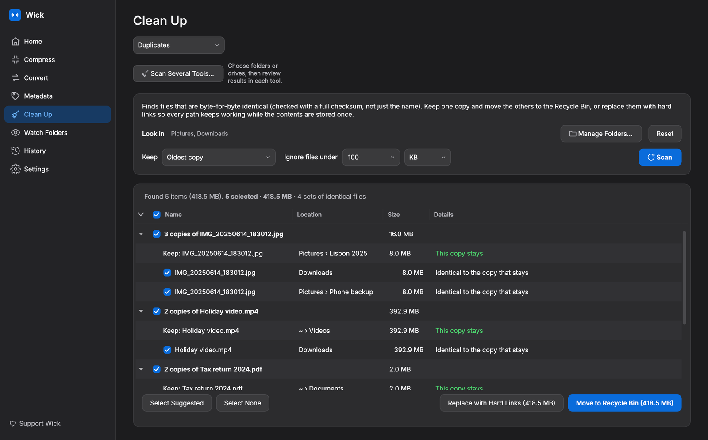

<p align="center"></p>

<h1 align="center">Wick</h1>

<p align="center">
Get gigabytes back from the photos, videos and music already on your PC.
<br>
Free and open source for Windows 10 and 11.
<br><br>
<a href="https://github.com/Lanntern/Wick/releases/latest"><b>Download</b></a> ·
<a href="docs/features.md">Features</a> ·
<a href="PRIVACY.md">Privacy</a> ·
<a href="https://ko-fi.com/lanntern">Ko-fi</a>
</p>

Point Wick at a folder, or right-click one in File Explorer. It shows how much space you'd get back before it
touches anything, then stores each file in a smaller format. Your originals go to the Recycle Bin, and History
can put them back.

<p align="center"></p>

## What it does

| Page | Use it to |
|---|---|
| **Home** | See where the easy savings are in your Pictures, Videos, Downloads, Desktop and Documents |
| **Compress** | Shrink photos, videos, music and Office/PDF documents |
| **Convert** | Change file formats, e.g. HEIC to JPEG or a video to MP4 |
| **Metadata** | See what a photo or video gives away (location, camera, author) and remove it |
| **Clean Up** | Find duplicates, similar photos, old installers, caches, build folders and Windows leftovers, and uninstall apps you no longer use |
| **Watch Folders** | Compress new files as they arrive, from the tray |
| **History** | Undo any run, or a single file |

<p align="center"></p>

## What it shrinks

| Your files | By default they become | Other choices |
|---|---|---|
| JPEG photos | Lossless JPEG XL, which converts back to the exact original JPEG | A smaller JPEG, WebP, AVIF |
| PNG, GIF, BMP, TIFF | JPEG XL, pixel-identical | The same format made smaller, WebP, AVIF |
| HEIC, AVIF, WebP | JPEG XL, though these are already compressed so savings are smaller | The same format, WebP, AVIF |
| Videos, like H.264, MPEG and WMV | AV1 or HEVC, chosen per video | Your choice of codec, resolution and frame rate |
| WAV, AIFF, APE, WavPack | FLAC, about half the size, sample-for-sample identical | Opus, AAC or MP3 |
| Word, Excel, PowerPoint, PDF | The same file with smaller pictures inside | Scaling large pictures down |

Videos are encoded on your NVIDIA, Intel or AMD graphics card when possible, and on the processor otherwise.
Everything Wick needs comes in the download.

Presets cover the common cases: Photo archive, Screenshots, For sharing, Maximum savings and Keep compatible.
Smart quality tests each file and keeps the smallest version that still measures as visually identical. See
[all features](docs/features.md).

## Your files stay safe

Scanning only reads your files. Nothing changes until you press Compress, and each result is checked before it
replaces the original: lossless results must match pixel for pixel, and videos are test-played at the start and
end.

Originals go to the Recycle Bin, so History can put them back. You can also save results next to the
originals or in another folder instead. Photos converted losslessly to JPEG XL can be turned back into the exact
original JPEG even after the bin is emptied.

Wick skips program and game folders, drives without a Recycle Bin, Motion and Live Photos, Dolby Vision video,
and files that wouldn't get noticeably smaller.

> Wick is designed not to lose files, but it comes with **no warranty**. Keep backups of files that matter,
> and check the results before you empty the Recycle Bin.

## Download

From the **[Releases page](https://github.com/Lanntern/Wick/releases/latest)** (64-bit Windows 10 or 11):

| File | What it is |
|---|---|
| `Wick-setup.exe` | Installer (recommended). Adds Start menu shortcuts and the File Explorer right-click menu. |
| `Wick-windows.zip` | Portable version. Unzip anywhere and run `Wick.exe`. |

Or with [Scoop](https://scoop.sh):

```
scoop bucket add wick https://github.com/Lanntern/Wick
scoop install wick
```

Wick isn't code-signed yet, so Windows may show "Windows protected your PC" the first time. Choose
**More info → Run anyway**. To check a download, see [Verifying a release](docs/features.md#verifying-a-release).

To see `.jxl` photos in Photos and File Explorer, install Microsoft's free
[JPEG XL Image Extension](https://apps.microsoft.com/detail/9MZPRTH5C0TB). Most browsers and chat apps can't
open JPEG XL yet, so use WebP for pictures you send to people.

**macOS** (Apple silicon): `Wick-macos-arm64.dmg` from the Releases page, or
`brew tap lanntern/wick https://github.com/Lanntern/Wick` then `brew install --cask wick`. It isn't signed by
Apple yet; see [Wick on macOS](docs/macos.md).

## Privacy

Wick has no accounts, ads or tracking, and your files are never uploaded. It only goes online to check GitHub
for a new version, weekly by default, and to download Pandoc if you ask it to convert a document. The
[privacy policy](PRIVACY.md) has the details.

## More

- [Command line](docs/features.md#command-line): `wick scan`, `wick run`, `wick undo` and more.
- [AI assistants](docs/mcp.md): Claude and other MCP apps can plan and run compressions in folders you allow.
  Wick asks you in its own window before changing anything.
- Keyboard: everything works without a mouse. Press `F1` in the app to see the shortcuts.
- [Running from source](CONTRIBUTING.md#running-from-source)
- [Reporting a security issue](SECURITY.md)

## Support Wick

Wick is free, with no paid version. If it saved you some space, a star here or a tip on
[Ko-fi](https://ko-fi.com/lanntern) is appreciated.

## License

Copyright © 2026 Lanntern. Wick is free software under the **GNU General Public License, version 3** only
([LICENSE](LICENSE)), and comes **without any warranty**, without even the implied warranty of merchantability
or fitness for a particular purpose.

The Windows build includes third-party programs and libraries (FFmpeg, libjxl, gifsicle, Qt and others). Their
licenses and source code links are in [THIRD-PARTY-NOTICES.md](THIRD-PARTY-NOTICES.md). Contributions are
welcome under the [Contributor License Agreement](CLA.md); see [CONTRIBUTING.md](CONTRIBUTING.md).

**Name and logo:** the Wick name and icon identify the official releases from this repository and aren't
covered by the GPL. Forks are welcome under the GPL, but please give yours a different name and icon. "Based
on Wick" is fine.
